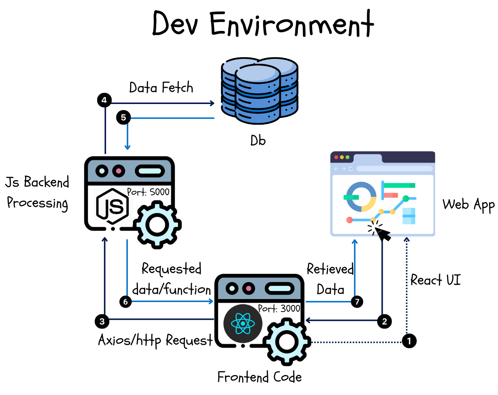

During my summer internship, I was tasked with building a full-stack web application to meet the company’s needs. The technology was completely new to me, so it took quite a bit of time to understand how the different components—Node.js for the backend, React for the frontend, and a database—fit together. In this blog, I will explain the general structure of a Node-React full-stack application wrt programming perspective.

> **Note:** This is a beginner's guide, and the structure outlined here will be used in the <ins>**development environment**</ins>.  To deploy the application to *production*, several changes need to be made, including modifications to the backend .env file and converting the React frontend to static JavaScript files. I plan to cover more details on this in my upcoming blogs.
{: .prompt-info }

---
### Components of a Full Stack Web App
1. Frontend Development
- It is the visible part of a website responsible for user experience.
- Responsible for user interaction.
- Calls the backend api.

2. Backend Development
- It involves the server-side development of websites, focusing primarily on their functionality.
- Responsible for managing the database through queries and APIs based on client-side commands.

3. Database
- An organized collection of related data that enables efficient retrieval, insertion, and deletion of information.

---

As shown in the picture, this illustrates the flow of a query from the frontend to the backend and to the database, then back.

### Points to Note
- It is considered best practice to separate the client-side frontend code from the server-side backend code by organizing them into distinct folders.
- If you are using a Node-React technology stack, it's important to note that the backend routes and frontend routes are different.
- During the development of your web application, you will need to run the React development server on a specific port, such as 3000, while the Node server should be started on a different port, like 5000. This setup allows the front end to send requests to the appropriate REST API (back-end route) to perform functions or fetch data. *(PS: in the PROD environment, the frontend and the backend are bundled up to use a single port)*
- If you are using MySQL or a similar relational database, the Node.js server will typically query the data on the default port 3306. However, if you wish to change this default port, you can specify the new port in the environment variables. *(More details on this will be covered in a future blog post.)*

The ports really confused me in the beginning, but once the *WHY* and *HOW* of things is clear, everything becomes a piece of cake. This was a brief overview of the structure of a full stack application. I plan to write more blogs about this particular setup, so stay tuned! 😊
